 
    
  
whoami

Third-year Computer Engineering student at PVGCOETM, Pune. I pick a concept, build it end to end, then dig into why it behaves the way it does. My work sits at applied AI/ML, computer vision, and local-first software: embedded storage and low-overhead protocols instead of heavy cloud abstractions.

<table> <tr> <td width="50%" valign="top">

Now learning

Deep learning from scratch in PyTorch (Karpathy's Zero to Hero)
Reinforcement learning: MDPs, Q-Learning, SARSA
State space models (Mamba), my technical seminar topic </td> <td width="50%" valign="top">

Now building

Drishti: offline codebase explorer
ORBIT: local-first productivity workspace
Rheo / KinetiX: real-time fatigue tracking
DSA in Java, in public </td> </tr>
</table>  
Featured work
<table> <tr> <td width="50%" valign="top"> <h3>Drishti (दृष्टि)</h3>    Local AI codebase explorer. Parses repos into Tree-sitter ASTs, embeds code with Jina <code>v2-base-code</code>, and indexes vectors in FAISS backed by SQLite, so you can query a codebase fully offline.   <code>Next.js</code> · <code>TypeScript</code> · <code>FastAPI</code> · <code>Tree-sitter</code> · <code>FAISS</code> · <code>SQLite</code> </td> <td width="50%" valign="top"> <h3>ORBIT</h3>    Local-first personal productivity workspace with zero cloud dependency. <code>better-sqlite3</code> and Drizzle ORM in WAL mode, with strict Zod validation at every boundary.   <code>Next.js</code> · <code>TypeScript</code> · <code>Tailwind</code> · <code>Zustand</code> · <code>Drizzle</code> · <code>SQLite (WAL)</code> </td> </tr> <tr> <td width="50%" valign="top"> <h3>Rheo / KinetiX</h3>    Real-time exercise and fatigue tracking. Streams video frames over binary WebSockets, extracts kinematic features, and predicts muscular fatigue with XGBoost, explained with SHAP.   <code>Python</code> · <code>Computer Vision</code> · <code>XGBoost</code> · <code>SHAP</code> · <code>WebSockets</code> </td> <td width="50%" valign="top"> <h3><a href="https://github.com/Prithvikatkar17/ai-attendance-system">Attendly</a></h3>    Multimodal biometric attendance. Face (<code>dlib</code>) and voice (<code>resemblyzer</code>) verification, separate teacher and student portals, and QR-code class enrollment to stop proxy attendance.   <code>Python</code> · <code>Streamlit</code> · <code>Supabase</code> · <code>dlib</code> · <code>librosa</code> </td> </tr> </table> 
 
<b>More experiments and coursework</b>
  
Project	Description
AdaIN Style Transfer	Neural style transfer from scratch using Adaptive Instance Normalization, in PyTorch
AIML	Deep learning implementations and coursework algorithms
java-dsa-journey	Structured DSA practice in Java, one topic at a time
RAG Cache Gateway (planned)	Exact-hash plus semantic cache over hybrid BM25 / vector retrieval (FastAPI, Redis Stack)

  
Stack
<table> <tr> <td><b>LANGUAGES</b></td> <td></td> </tr> <tr> <td><b>ML</b></td> <td></td> </tr> <tr> <td><b>WEB</b></td> <td></td> </tr> <tr> <td><b>DATA</b></td> <td></td> </tr> <tr> <td><b>INFRA</b></td> <td></td> </tr> </table>  
Contact

Open to AI/ML and software engineering internships. Email is the fastest way to reach me: prithvirajkatkar17@gmail.com
